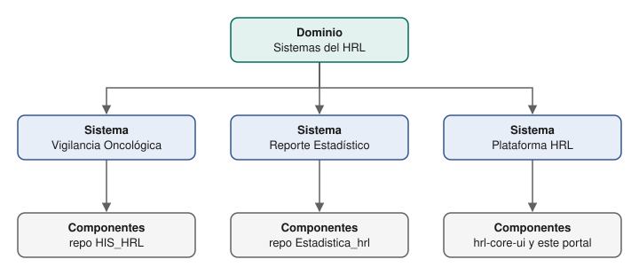

# Portal de Desarrollo HRL

Portal interno del Hospital Regional de Loreto construido con
[Backstage](https://backstage.io). Reúne en un solo lugar:

- **Catálogo**: sistemas, componentes, APIs, recursos y equipos responsables.
- **Documentación (TechDocs)**: el Markdown de la carpeta `docs/` de cada repo,
  publicado dentro del portal.
- **Búsqueda**: sobre el catálogo y la documentación.

## Cómo se organiza el catálogo

*Haz clic en el diagrama para ampliarlo. Para editarlo, abre el `.drawio.svg` en
draw.io o en su extensión de VS Code: el archivo guarda el diagrama editable.*

Cada sistema es un **proyecto**: más adelante tendrá su propio subportal
(`/proyectos/<proyecto>`) con sus componentes, documentación y APIs, y la
cabecera indicará siempre en qué proyecto estás.

| Qué | Dónde se declara |
|---|---|
| Dominio, sistemas y equipos | `catalog/hrl.yaml` de este repo |
| Componentes, APIs y recursos | `catalog-info.yaml` en la raíz de cada repo de `DevHRL` |
| Documentación | `mkdocs.yml` y `docs/` de cada repo |

El portal revisa la organización `DevHRL` cada 30 minutos y registra solo los
repos que tengan `catalog-info.yaml`. Un proyecto nuevo aparece sin tocar la
configuración del portal.

## Páginas

- [Estado y pendientes](estado-y-pendientes.md): qué existe, qué se decidió y qué falta
- [Levantamiento local](levantamiento.md)
- [Documentar un repo con TechDocs](techdocs.md)
- [Idioma del portal](idioma.md)
- [Despliegue](despliegue.md)
- [Coolify: paso a paso](coolify-paso-a-paso.md)
